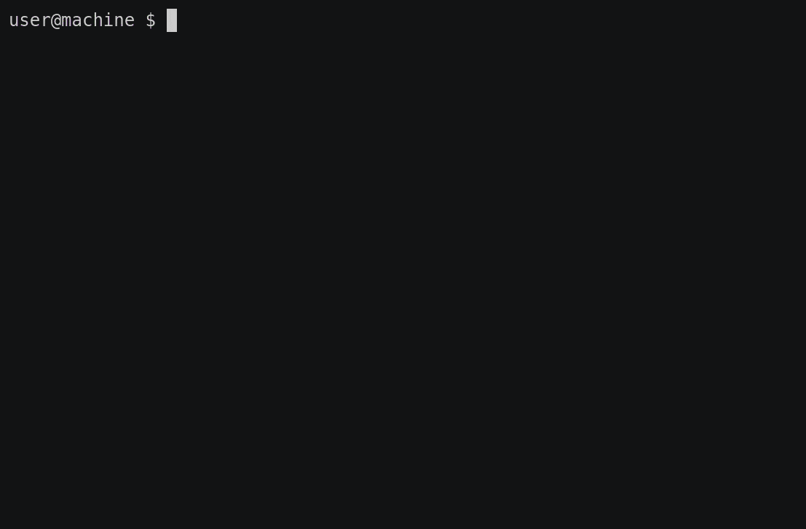

# rmatrix

Generates a 'Matrix'-like screen of falling characters in your terminal
[](https://asciinema.org/a/IjJyH88BeocsHvJpKJYqvmnuT)

The original [`cmatrix`](https://github.com/abishekvashok/cmatrix) was written in C, and crashes when you wildly resize the window.
The rust version is memory-safe, and doesn't crash so easily.
This version uses `crossterm` for cross-platform terminal support without needing `ncurses` installed.

## Install
```sh
cargo install --git https://github.com/Antidote1911/rmatrix
```
This installs the `rmatrix` binary.

## Options
| Option | Effect |
| -- | -- |
| `-b` | Bold white heads |
| `-B` | All characters bold (overrides `-b`) |
| `-o`, `--oldstyle` | Old-style scrolling |
| `-s`, `--screensaver` | "Screensaver" mode, exits on the first keystroke |
| `-u`, `--update <0-10>` | Screen update delay (default 4, 0 is fastest) |
| `-C`, `--colour <colour>` | `green` (default), `red`, `blue`, `white`, `yellow`, `cyan`, `magenta` or `black` |
| `-r`, `--rainbow` | Rainbow mode |
| `-f`, `--fade` | Fade the tail of the streams (needs a true colour terminal) |
| `-c`, `--katakana` | Japanese characters, as in the film (needs a font with half-width katakana) |
| `-a`, `--async` | Asynchronous scroll: each column falls at its own speed |
| `--completions <shell>` | Print the completion script for `bash`, `zsh`, `fish`, `elvish` or `powershell` |
| `--man` | Print the manual page |
| `-V`, `--version` | Print the version |

## Controls
| Key | Control |
| -- | -- |
| `q`, `Ctrl-C` | Quit |
| `p` | Pause / resume |
| `0`-`9` | Speed the letters fall (0 is fastest, 9 is slowest) |
| `↑` / `↓` | Faster / slower (works on every keyboard layout) |
| `b` / `B` / `n` | Bold heads / all bold / bold off |
| `!` `@` `#` `$` `%` `^` `&` | Red, green, yellow, blue, magenta, cyan, white (Shift + 1-7 on a US keyboard) |
| `c` | Next colour (works on every keyboard layout) |
| `r` | Rainbow mode on / off |
| `f` | Fade on / off |
| `k` | Japanese characters on / off |
| `a` | Asynchronous scroll on / off |

## Shell completions and manual page
```sh
rmatrix --completions zsh > ~/.zfunc/_rmatrix   # or bash, fish, elvish, powershell
rmatrix --man > ~/.local/share/man/man1/rmatrix.1
```

